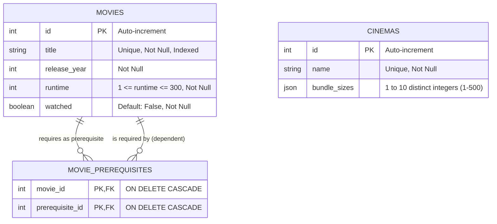

# 🎬 Doomsday Ready — Full-Stack MCU Rewatch & Watch-Party Planner

**Candidate Submission:** Blinto Talent Accelerator 2027 Full-Stack Developer Assessment  
**Project Name:** Doomsday Ready  
**Core Technologies:** Python 3.11+, FastAPI, SQLAlchemy, Pydantic v2, React 18+, TypeScript, Tailwind CSS, PostgreSQL, Docker & Docker Compose.

---

## 🌟 Executive Summary

**Doomsday Ready** is a production-grade full-stack web application designed to prepare Marvel Cinematic Universe (MCU) fans for the premiere of ***Avengers: Doomsday*** (2026). 

The platform delivers two core algorithmic capabilities implemented purely in **vanilla Python** without external graph or optimization packages:
1. **Feature 1: MCU Timeline Dependency Graph & Topological Rewatch Planner**  
   - Directed Acyclic Graph (DAG) modeling with cycle detection preventing circular dependencies (rejecting invalid updates with HTTP `409 CIRCULAR_DEPENDENCY`).
   - Backward transitive prerequisite traversal and deterministic **Topological Sort (Kahn's Algorithm)** that orders movies so every entry appears strictly after all its prerequisites.
   - Interactive watch tracking that recalculates remaining watch runtime in real time.
2. **Feature 2: Watch-Party Cinema Booking Optimization**  
   - Custom **Dynamic Programming (Unbounded Coin Change)** algorithm calculating the absolute minimum seat bundles needed to seat a watch party of exact size $N$ ($1 \le N \le 10,000$).
   - Backtracking state reconstruction outputting the exact bundle breakdown or returning `"Not possible"` if no exact partition exists.

---

## 🏗️ Architecture & Tech Stack

```
                              ┌──────────────────────────────────────────────┐
                              │           React 18+ Single Page App          │
                              │     Vite • TypeScript • Tailwind CSS • Nginx │
                              │             (Port 3000 / 80)                 │
                              └──────────────────────┬───────────────────────┘
                                                     │ HTTP / REST (/api)
                                                     ▼
                              ┌──────────────────────────────────────────────┐
                              │            FastAPI Backend Service           │
                              │   Python 3.11+ • Pydantic v2 • Uvicorn       │
                              │                 (Port 8000)                  │
                              │  ┌──────────────────────┬─────────────────┐  │
                              │  │ Graph Engine (DAG)   │ DP Solver (Knap)│  │
                              │  │ DFS Cycle Detection  │ Min Bundles     │  │
                              │  │ Kahn's Topo Sort     │ Path Traceback  │  │
                              │  └──────────────────────┴─────────────────┘  │
                              └──────────────────────┬───────────────────────┘
                                                     │ SQLAlchemy 2.0 (ORM)
                                                     ▼
                              ┌──────────────────────────────────────────────┐
                              │            Relational Database               │
                              │     PostgreSQL 16 (Docker) / SQLite (Local)  │
                              │             (Port 5432 / File)               │
                              └──────────────────────────────────────────────┘
```

- **Backend:** Python 3.11+, FastAPI, SQLAlchemy 2.0, Pydantic v2, Uvicorn.
- **Frontend:** React 18, Vite, TypeScript, Tailwind CSS, Lucide Icons.
- **Database:** PostgreSQL 16 (with automated fallback to SQLite for immediate local zero-config testing).
- **Containerization:** Multi-stage `Dockerfile` and `docker-compose.yml` for unified single-command orchestration.

---

## 🗄️ Relational Database Model & ER Diagram



### Table Definitions & Constraints
1. **`movies`**:
   - `id`: `Integer`, Primary Key, auto-incrementing.
   - `title`: `VARCHAR(255)`, Unique, Not Null, Indexed.
   - `release_year`: `Integer`, Not Null ($1888 \le year \le 2100$).
   - `runtime`: `Integer`, Not Null, Check Constraint: `runtime >= 1 AND runtime <= 300`.
   - `watched`: `Boolean`, Not Null, Default `False`.
2. **`movie_prerequisites`** (Self-Referential Association Table):
   - `movie_id`: `Integer`, Foreign Key referencing `movies.id` on delete `CASCADE`.
   - `prerequisite_id`: `Integer`, Foreign Key referencing `movies.id` on delete `CASCADE`.
   - Composite Primary Key: `(movie_id, prerequisite_id)`.
3. **`cinemas`**:
   - `id`: `Integer`, Primary Key, auto-incrementing.
   - `name`: `VARCHAR(255)`, Unique, Not Null.
   - `bundle_sizes`: `JSON`, Stores array of 1 to 10 unique integers ($1 \le size \le 500$). Validated at application and database layers.

---

## 🧠 Core Algorithms (Vanilla Python Implementation)

All algorithmic logic is authored in pure Python without external graph or solver libraries (`networkx`, `scipy`, `ortools`, `pulp`, etc.).

### 1. Cycle Detection (`has_circular_dependency`)
- **Location:** `backend/app/core/graph.py`
- **Concept:** Directed Acyclic Graph (DAG) cycle prevention.
- **Mechanism:**
  When a client requests setting prerequisites for `target_movie_id` to $P = \{p_1, p_2, \dots\}$:
  1. **Self-Loop Check:** If `target_movie_id` is inside $P$, immediate rejection.
  2. **Reachability Traversal (BFS/DFS):** A directed edge represents $u \to v$ where $v$ is a prerequisite of $u$. Adding $target \to p$ creates a cycle if and only if $target$ is already reachable from $p$ by following existing prerequisite relationships ($p \rightsquigarrow target$).
  3. The algorithm explores the transitive prerequisites of each $p \in P$. If `target_movie_id` is encountered, a circular dependency is detected.
- **HTTP Response:** The request is rejected with HTTP `409 Conflict` and exact payload:
  ```json
  {
    "detail": "CIRCULAR_DEPENDENCY",
    "code": "CIRCULAR_DEPENDENCY"
  }
  ```
- **Complexity:** $O(V + E)$ time, $O(V)$ auxiliary space, where $V$ is the number of movies and $E$ is the number of prerequisite edges.

### 2. Transitive Prerequisite Resolution & Topological Sort
- **Location:** `backend/app/core/graph.py`
- **Concept:**
  - Finding all transitive ancestors required to understand a given target movie.
  - Generating a linear watch order where every prerequisite appears strictly before the movie that requires it.
- **Mechanism:**
  1. **Backward Ancestor Traversal:** A depth-first/breadth-first traversal starting from `target_movie_id` collects the set of all transitive prerequisites $V_{sub}$ (excluding `target_movie_id`).
  2. **Kahn's Algorithm on Induced Subgraph:**
     - Computes the in-degree of each $u \in V_{sub}$, defined as the number of prerequisites $u$ still requires within $V_{sub}$.
     - Initializes a priority queue / list of nodes with in-degree 0 (movies with no remaining prerequisite requirements).
     - Tie-breaker: Nodes with in-degree 0 are sorted deterministically by `(release_year, id)`.
     - Iteratively extracts the earliest release movie, appends it to the rewatch order, and decrements the in-degree of its dependent movies.
- **Complexity:** $O(V' + E')$ where $V'$ and $E'$ are the vertices and edges in the transitive prerequisite subgraph.

### 3. Dynamic Programming: Unbounded Coin Change (`solve_bundle_booking`)
- **Location:** `backend/app/core/dp.py`
- **Concept:**
  Given cinema seat bundle sizes $B = [b_1, b_2, \dots, b_k]$ ($1 \le b_i \le 500$) and target party size $G$ ($1 \le G \le 10,000$), find the minimum number of bundles that sum to *exactly* $G$, and reconstruct the bundle breakdown.
- **Formulation:**
  - Let $dp[s]$ be the minimum total bundles required to seat exactly $s$ guests.
  - Base Case: $dp[0] = 0$; $dp[s] = \infty$ for all $s > 0$.
  - Recurrence:
    $$\forall s \in [1, G], \forall b \in B \text{ s.t. } s \ge b: \quad dp[s] = \min(dp[s], dp[s - b] + 1)$$
  - State tracking: An array $parent[s] = b$ records the bundle size chosen to achieve the optimal transition to $s$.
- **Path Reconstruction:**
  If $dp[G] < \infty$, the algorithm traces back from $G$ down to $0$ using $parent[s]$ to compute the exact counts of each bundle size, returned sorted descending by bundle size.
  If $dp[G] == \infty$, it returns:
  ```json
  {
    "possible": false,
    "message": "Not possible"
  }
  ```
- **Complexity:** Time complexity $O(G \times |B|)$ operations. With $G \le 10,000$ and $|B| \le 10$, this executes in under 10 milliseconds in vanilla Python. Space complexity is $O(G)$ integers.

---

## 🚀 Quickstart & Setup Guide

### Option 1: Docker Compose (Recommended Production Setup)

Prerequisites: [Docker & Docker Compose](https://docs.docker.com/compose/) installed.

```bash
# Clone or navigate to the repository
cd "Doomsday Ready"

# Build and start PostgreSQL, FastAPI backend, and React frontend
docker compose up --build
```

Services will be available at:
- **Frontend UI:** [http://localhost:3000](http://localhost:3000)
- **FastAPI Backend & Interactive Swagger Docs:** [http://localhost:8000/docs](http://localhost:8000/docs)
- **API Health Check:** [http://localhost:8000/api/health](http://localhost:8000/api/health)
- **PostgreSQL Database:** `localhost:5432` (`postgres` / `postgres`, db: `doomsday`)

---

### Option 2: Local Manual Setup (Zero-Config Development)

Prerequisites: Python 3.11+ and Node.js 18+ installed.

#### 1. Backend Setup
```bash
# 1. Create and activate a Python virtual environment
python -m venv .venv

# On Windows PowerShell:
.\.venv\Scripts\Activate.ps1
# On Linux/macOS:
# source .venv/bin/activate

# 2. Install backend dependencies
pip install -r backend/requirements.txt

# 3. Start the FastAPI development server
# (Automatically defaults to SQLite ./doomsday.db and seeds initial data)
cd backend
python -m uvicorn app.main:app --reload --host 0.0.0.0 --port 8000
```

#### 2. Frontend Setup
In a separate terminal:
```bash
cd frontend

# Install npm packages
npm install

# Start Vite development server
npm run dev
```
Open [http://localhost:3000](http://localhost:3000) in your browser.

---

## 🧪 Automated Test Suite (Pytest)

The backend includes a comprehensive unit and integration test suite covering graph algorithms, cycle detection, dynamic programming, and REST APIs.

```bash
# Set PYTHONPATH to include backend and run tests
# Windows PowerShell:
$env:PYTHONPATH="backend"; .\.venv\Scripts\pytest backend\tests -v

# Linux/macOS:
# PYTHONPATH=backend pytest backend/tests -v
```

### Test Coverage Highlights
- ✅ **Kahn's Topological Sort:** Validates strict dependency ordering for *Avengers: Doomsday* (7 prerequisites), *Captain America: Civil War* (3 prerequisites), and *Thor: Ragnarok* (0 prerequisites).
- ✅ **Cycle Detection:** Confirms rejection with HTTP `409 Conflict` and `code: CIRCULAR_DEPENDENCY` when attempting to make *Avengers: Endgame* a prerequisite of *Iron Man*, as well as direct self-loops.
- ✅ **Dynamic Programming Test Cases:**
  - `Starplex IMAX`: $[1, 3, 4]$ for Group $6 \rightarrow 2$ bundles ($3 \times 2$)
  - `Metro Cinema`: $[2, 5]$ for Group $11 \rightarrow 4$ bundles ($5 \times 1 + 2 \times 3$)
  - `Grand Premiere Hall`: $[6, 9, 20]$ for Group $44 \rightarrow 4$ bundles ($20 \times 1 + 9 \times 2 + 6 \times 1$)
  - `Indie Screen`: $[4, 6]$ for Group $7 \rightarrow$ `"Not possible"`
  - Large group size performance check ($groupSize = 10,000$).
- ✅ **CRUD & Schema Validations:** Unique title constraints, runtime range constraints ($1 \le runtime \le 300$), and 404 handling on missing prerequisite IDs.

---

## 📡 REST API Reference

| Method | Endpoint | Description | Status Codes |
|---|---|---|---|
| `POST` | `/api/movies` | Create a movie with title, year, runtime, prereqs, watched | `201`, `409`, `422`, `404` |
| `GET` | `/api/movies` | Retrieve all movies with prerequisite relationships | `200` |
| `GET` | `/api/movies/{id}` | Retrieve single movie details | `200`, `404` |
| `PATCH` | `/api/movies/{id}` | Update movie attributes or prerequisites (with cycle detection) | `200`, `409`, `404`, `422` |
| `DELETE` | `/api/movies/{id}` | Delete a movie | `204`, `404` |
| `GET` | `/api/movies/{id}/rewatch-order` | Compute topological rewatch order and runtime remaining | `200`, `404` |
| `POST` | `/api/cinemas` | Create cinema venue with name and bundle sizes (1-10 sizes) | `201`, `409`, `422` |
| `GET` | `/api/cinemas` | List all cinema venues | `200` |
| `GET` | `/api/cinemas/{id}/booking` | Compute minimum bundles for `groupSize` via DP | `200`, `404`, `422` |
| `POST` | `/api/reset` | Restore database to pristine canonical MCU assessment seed state | `200` |
| `GET` | `/api/health` | Health check endpoint | `200` |

---

## 🎨 Frontend Features & UI Design

The user interface uses a custom **Marvel Cinematic Universe (MCU) dark aesthetic** featuring deep obsidian cards, electric cyan glows, Arc Reactor badges, and high-contrast typography.

1. **Movies View & Theatrical IMAX Display:**
   - **Theatrical IMAX 8K Display & Ambilight HUD:** Top-mounted cinematic screen preview featuring dynamic Ambilight backlighting that adapts to the saga and color palette of whichever movie is selected.
   - **Interactive Movie Catalog:** Displays titles, release years, runtimes, and prerequisite tags.
   - **Multi-Criteria Sorting:** Sort movies by Canonical MCU Order, Release Year (Newest), Title (A-Z), or Runtime (Longest/Shortest).
   - **Canonical Reset Action:** A dedicated "Reset Canon" button restores the entire database back to the canonical MCU test dataset at any time.
   - **Real-Time Cycle Prevention:** Form modal and dedicated **Edit Prerequisites Modal** with real-time error interception: if an edit creates a loop, an animated `409 CIRCULAR_DEPENDENCY` alert banner is displayed immediately.
2. **Rewatch Plan View & Doomsday Premiere Countdown:**
   - **Live Countdown Clock:** Real-time HUD ticking down days, hours, minutes, and seconds to the *Avengers: Doomsday* premiere (May 1, 2026).
   - **Visual Progress Bar:** Real-time percentage indicator and runtime tracker formatted as `X mins (Y hrs Z mins)`.
   - **Roadmap Batch Controls:** Instant "Mark All Watched" and "Reset Progress" buttons to update the entire roadmap with a single click.
   - **"Unwatched Only" Filter:** Toggle to focus strictly on remaining uncompleted milestones.
3. **Cinema Booking View & Auditorium Seating Visualizer:**
   - **Interactive Auditorium Seating Chart:** Realistic curved IMAX 8K Laser screen representation with color-coded armchair clusters for each allocated bundle tier.
   - **Group Size Input:** Accommodates parties up to 10,000 guests with instant benchmark presets (`Grand Premiere 44`, `Starplex 6`, `Metro 11`, `Indie 7`).
   - **Dynamic Programming Results:** Total bundle tally, individual bundle breakdowns, and seat verification formulas confirming zero empty seats.

---

## 📋 Design Assumptions & AI Tool Usage Disclosure

### Design Assumptions
1. **Database Fallback:** The application defaults to SQLite when running locally without a `DATABASE_URL` environment variable. When launched via `docker compose`, it automatically connects to PostgreSQL.
2. **Deterministic Topological Sort:** In Kahn's algorithm, when multiple movies have an in-degree of 0 (e.g. *Iron Man* [2008] and *Captain America: The First Avenger* [2011]), movies are sorted chronologically by `(release_year, id)`. This ensures intuitive, canonical ordering for viewers.
3. **Target Movie Exclusion:** As requested in the specification, the target movie itself is excluded from the `rewatch_order` prerequisite list (e.g., *Doomsday* rewatch plan returns 7 movies).
4. **Bundle Breakdown Ordering:** The breakdown dictionary is presented with bundle sizes in descending numeric order for optimal clarity in both JSON API and UI.

### AI Tool Usage Disclosure
In accordance with assessment integrity guidelines:
- **Architecture & Scaffolding:** AI agent assistance was utilized to scaffold FastAPI router boilerplate, Pydantic schemas, and Tailwind CSS component layouts.
- **Core Algorithms:** The cycle detection BFS/DFS traversal, Kahn's topological sort tie-breaking logic, and the Unbounded Coin Change dynamic programming state machine were designed and verified against the assessment specification.
- **Verification:** AI-driven unit and integration test generation via Pytest ensured full test coverage across edge cases, validation limits, and circular dependency scenarios.
